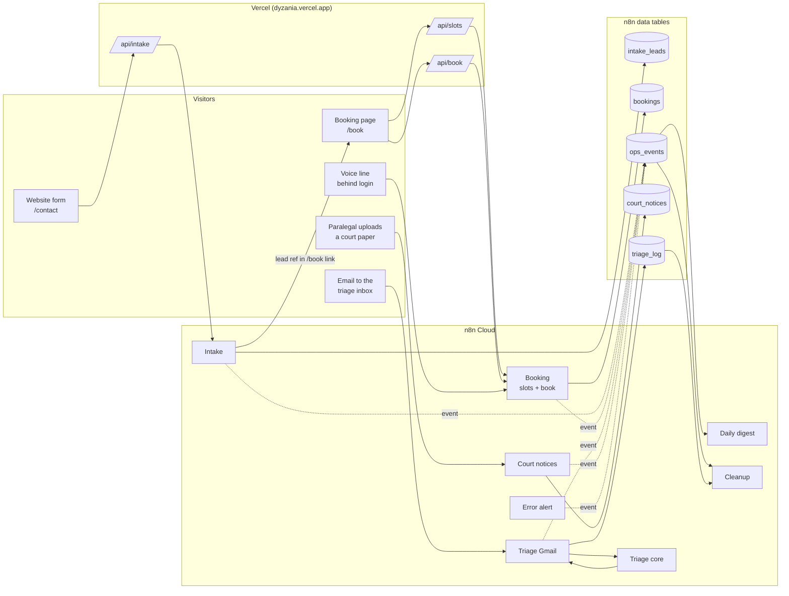
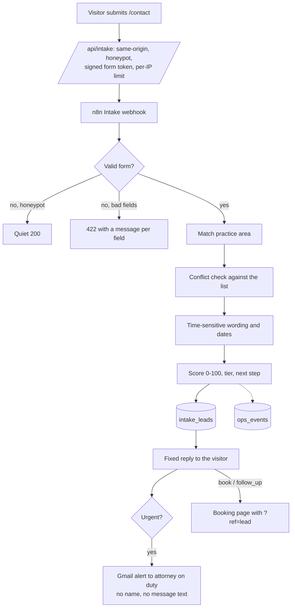
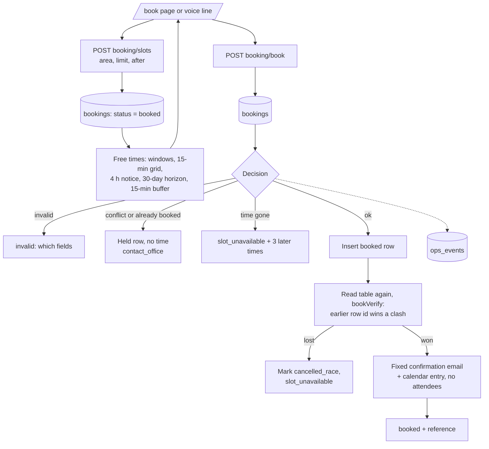
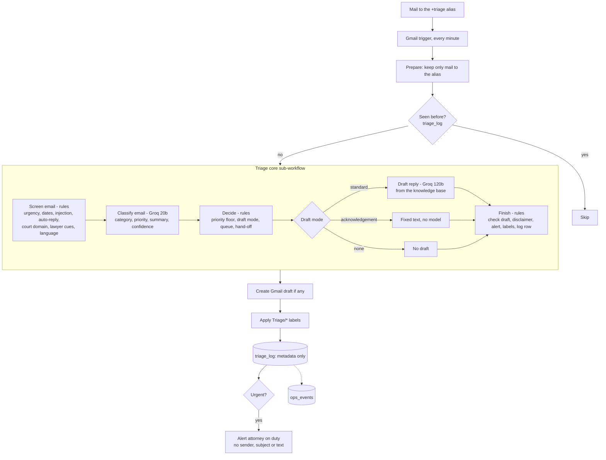
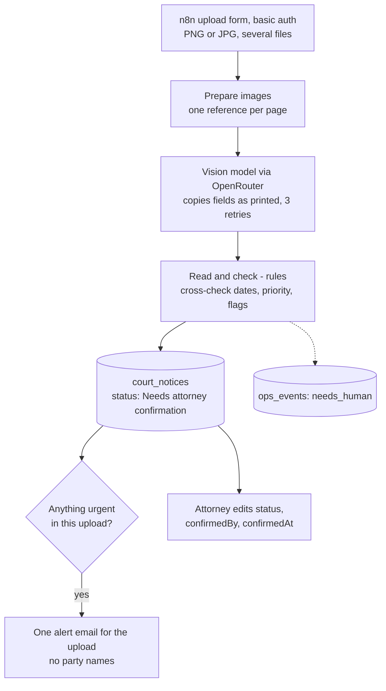
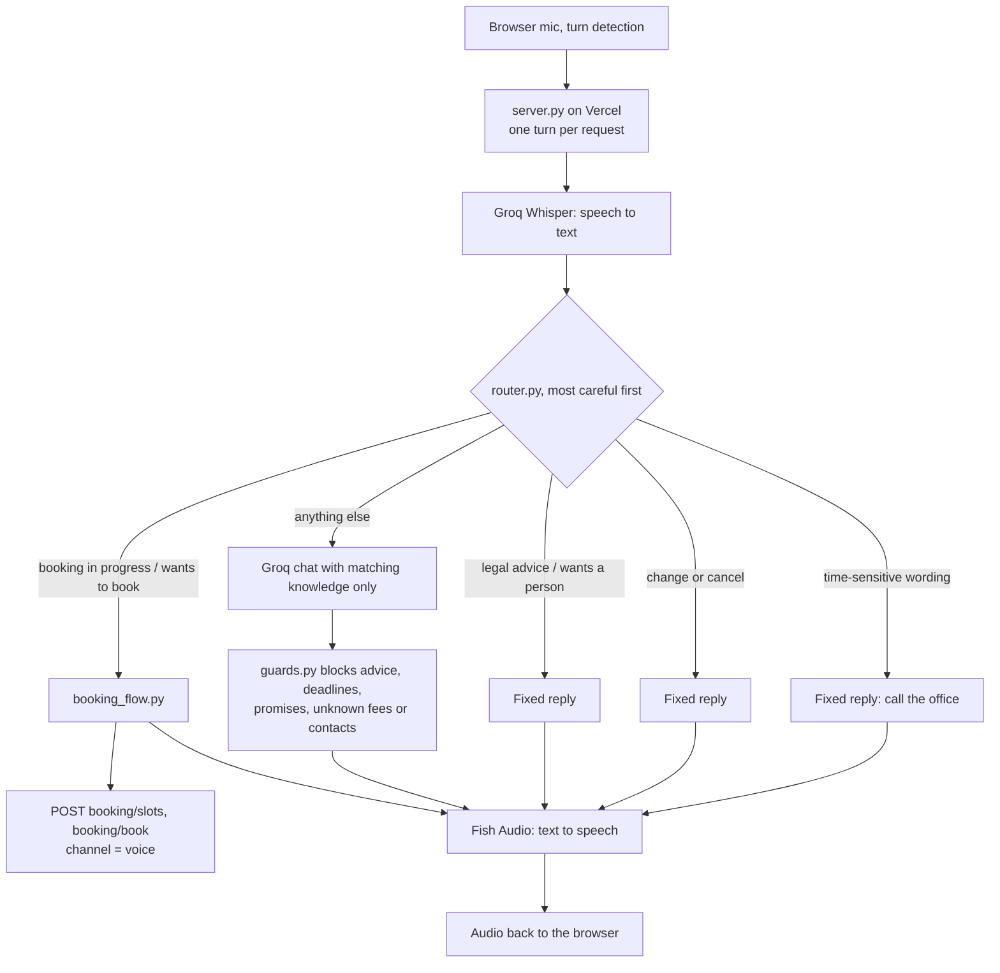
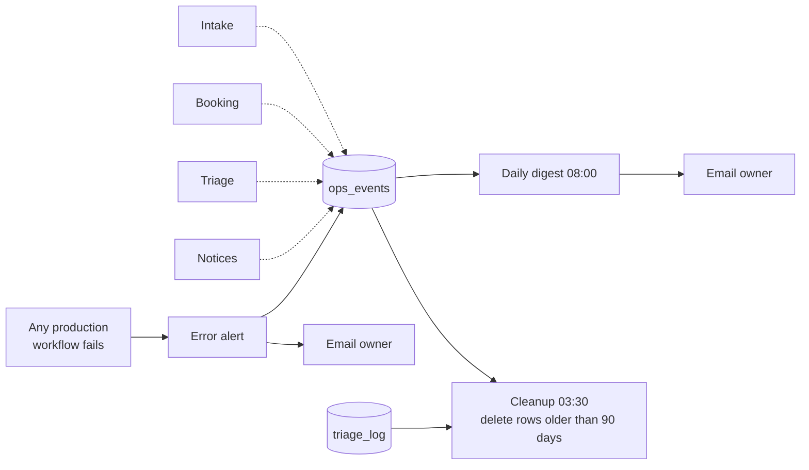

# Dyzania automations: data flow, specs and how to use them

Dyzania LLP is a fictional law firm made for a portfolio project. Every person, court, case and address here is invented.

This page puts all eight live n8n workflows and the voice line in one place: where the data goes, what each one decides, and how to run it. Each automation's own README has the full rules and the evaluation results. This page is the map.

## The whole system

Rules that hold everywhere:

- **Drafts only.** Nothing writes to a client on its own judgment. The one automatic email is the fixed booking confirmation, sent only to the address that booked.
- **Rules decide, models suggest.** A model can only make handling more careful. Urgency, conflicts, the attorney and every priority floor are tested rules.
- **No legal advice.** Nothing says whether someone has a case, what a deadline is, or what will happen.
- **A person confirms every court notice.** No code path can set any status other than "Needs attorney confirmation".
- **Metadata only in logs and alerts.** `ops_events`, `triage_log` and every alert hold references and categories, never names, addresses or message text. Workflows that see personal data have execution saving switched off.

## The workflows at a glance

| Automation | n8n workflow ID | Trigger | Model | Writes to | Emails |
|---|---|---|---|---|---|
| Intake | `ps5uC4ph437kf1Vy` | Webhook `POST /intake` (header auth) | none | `intake_leads`, `ops_events` | Attorney on duty, urgent leads only |
| Booking | `UJqGbsvvIWFHmAEx` | Webhooks `POST /booking/slots` and `POST /booking/book` (header auth) | none | `bookings`, `ops_events`, Google Calendar | Fixed confirmation to the person who booked |
| Triage Gmail | `fxBLONZtkgMR9yL2` | Gmail poll, every minute | (calls core) | `triage_log`, `ops_events`, Gmail drafts and labels | Attorney on duty, urgent mail only |
| Triage core | `5C10PcqRrpHxLOR1` | Called by Triage Gmail (sub-workflow) | Groq `gpt-oss-20b` (classify), `gpt-oss-120b` (draft) | nothing (returns a result) | none |
| Court notices | `6sNm9S5ia1tOx28W` | n8n form (basic auth, PNG/JPG upload) | OpenRouter vision model | `court_notices`, `ops_events` | One alert per upload, urgent only |
| Error alert | `TISzR1bG0KiR9pDX` | Any production workflow fails | none | `ops_events` | Owner only |
| Daily digest | `yA70Gs8KSabDJgkv` | Every day 08:00 | none | `ops_events` (its own run) | Owner only |
| Cleanup | `XUnf2vYcrFDYUcnm` | Every night 03:30 | none | deletes old `ops_events` and `triage_log` rows | none |
| Voice line | Vercel project `voice-agent` | A call in the browser (behind Vercel login) | Groq Whisper (speech), Groq chat; Fish Audio (voice) | through Booking | through Booking |

The Code nodes of intake, booking, triage and notices are **generated** from tested libraries by `scripts/build-*-workflow.mjs`. To change a rule: edit the library or the data in `firm/`, run that folder's `npm test`, rebuild, then copy the new node code into the live workflow and publish. `--check` on each build script fails if the committed workflow file is out of date.

---

## 1. Intake: lead intake and scoring

**What it is for:** a visitor fills in the website form. Intake checks it, matches a practice area, runs a conflict check, flags time-sensitive wording, scores the lead and decides the next step. No model.

**Specs**

| Item | Value |
|---|---|
| Input fields | `name`, `email`, `phone`, `preferredContact`, `area`, `description`, `location`, `hearing`, `incidentDate`, `otherSide`, `howHeard`, consent, honeypot |
| Score | Area fit 35, location 15, time-sensitivity 20, detail 20, contactability 10 |
| Tiers | Hot 75+, Warm 50+, Low below; a conflict hold caps Hot at Warm |
| Next steps (first that applies) | `not_a_fit`, `refer_out`, `hold_conflict`, `attorney_now`, `ask_more`, `follow_up`, `book` |
| Urgent | Court date, served papers, deadline within 7 days or past, safety, arrest, lockout |
| What the visitor learns | One of `book`, `follow_up`, `urgent`, `refer`, `review`. Never that a conflict matched |
| Table | `intake_leads`, 27 columns (`automations/intake/columns.json`). No automatic deletion |
| Evidence | 48 invented leads, 48 of 48 on every field. Same-author set |

**How to use it**

1. Open `https://dyzania.vercel.app/contact` and fill in the form with invented details.
2. The page shows the next step. If it is `book` or `follow_up`, it links to `/book` with your lead reference.
3. Look for the row in the `intake_leads` table in n8n. An urgent lead also sends an alert to the attorney-on-duty address.
4. Change rules in `automations/intake/lib/intake.js` or `firm/*.json`, then `cd automations/intake && npm test`, then `node scripts/build-intake-workflow.mjs`.

---

## 2. Booking: first consultations

**What it is for:** shows free first-consultation times for a practice area and books the one a person picks. The website and the voice line call the same two endpoints. No model.

**Specs**

| Rule | Value |
|---|---|
| Length | 45 min family and estate, 30 min injury and employment |
| Fee line | $150 credited to the retainer (family, estate); free (injury, employment) |
| Notice / horizon | At least 4 hours ahead; up to today + 30 days |
| Buffer | 15 minutes between consultations, counted once |
| One booking per person | Same email or same phone, future bookings only |
| Conflict check | Must be `clear`, otherwise a held row and `contact_office` |
| Attorney | The rules pick: fewest future bookings, then list order |
| Answer codes | `booked`, `invalid`, `slot_unavailable`, `contact_office`, `unavailable` (all HTTP 200) |
| Table | `bookings`, 18 columns. Status `booked`, `held`, `cancelled`, `cancelled_race` |
| Evidence | 86 labelled cases 86 of 86; brute-force oracle agrees on 72 scenarios; 46 of 46 deliberate breakages caught |

**How to use it**

1. Open `https://dyzania.vercel.app/book`, pick an area, then a time.
2. Fill in name, email and the other side (or tick that there is none) and agree to the terms.
3. The page shows the reference. The confirmation goes to the email you gave, so use an inbox you own.
4. Not built yet: cancel or change online (the office handles it), a holiday calendar, email verification.

---

## 3. Inbox triage (Gmail + core)

**What it is for:** sorts mail sent to the triage alias, flags anything time-sensitive, labels it, and saves a reply as a **Gmail draft that is never sent**. Courts, other lawyers, spam and manipulation attempts get no draft.

**Specs**

| Item | Value |
|---|---|
| Categories | `new_inquiry`, `existing_client`, `court_notice`, `opposing_counsel`, `scheduling`, `billing`, `spam`, `other` |
| Priority floors | Urgent wording or a date within 7 days: `urgent`. Later hearing or deadline: `high`. Court or another lawyer: `high`. Auto-reply and spam: `low`. Manipulation: the model cannot raise above `normal` |
| Draft modes | `none` (auto-reply, spam, manipulation, empty, lawyer, court, classifier failed), `acknowledgement` (urgent, or a court paper from a person; fixed EN/ES text), `standard` (model draft, checked) |
| Draft checks | Outcome promises, case opinions, legal advice, deadlines as fact, time promises, accepting a case, prompt leaks, links, addresses, phone numbers and amounts not in the knowledge base. A failed check becomes a holding reply |
| Manipulation screen | Instruction-like text and requests for client data (for example "a list of all current clients") are flagged by rules; the model can add more |
| Queues | `urgent`, `records`, `matter_attorney`, `case_team`, `intake`, `billing`, `front_desk`, `none` |
| Labels | `Triage/<Category>`, `Triage/P-<Priority>`, `Triage/Needs-Human`, `Triage/Injection-Suspected`, `Triage/Processed` |
| Table | `triage_log`, 21 columns, metadata only, deleted after 90 days |
| Evidence | 54 invented emails. Offline: a perfect model 54 of 54, guarantees hold for a hostile model on all 50 the rules can see. Live (12 Nov): category 50/54, every urgent email raised, every email that needed a person flagged |

**How to use it**

1. Send an email to the triage alias (the owner's Gmail address with `+triage`).
2. Within about a minute it gets `Triage/*` labels. If a draft is allowed, it sits in Gmail Drafts as a reply. Read it before sending.
3. Urgent mail also sends an alert to the attorney on duty.
4. Change the rules in `automations/triage/lib/`, the prompts in `automations/triage/prompts/`, then `npm test`, `npm run eval`, and `node scripts/build-triage-workflow.mjs`.

---

## 4. Court notices

**What it is for:** a paralegal uploads scans of court papers. A vision model copies what is printed; tested rules set the priority. Every row is saved as **Needs attorney confirmation**, and nothing can change that except a person.

**Specs**

| Item | Value |
|---|---|
| Urgent | Summons or subpoena; any printed date within 7 days or past; a poor scan; an unreadable date; a failed read |
| High | Any other court paper; a time limit counted from another event; text aimed at an automated system |
| Normal | Only a non-court paper with nothing wrong |
| Never | Works out a deadline, lowers a priority because of words like "vacated", follows text on the page |
| Table | `court_notices`, 28 columns. No automatic deletion |
| Evidence | 12 invented notices; perfect reader 12 of 12; 800 random readings agree with a separate restatement; 53 of 53 breakages caught. **No live model run yet** |
| Privacy | Images go to a third-party model. Only invented papers belong in the demo |

**How to use it**

1. Open the notices form URL from the n8n workflow (production URL of the form trigger) and sign in with the basic-auth credential.
2. Upload the 12 PNGs from `automations/notices/eval/samples` in one go.
3. Check the `court_notices` table and the alert email.
4. To score the run, export the 12 rows and run `node automations/notices/eval/score.js rows.json`.

---

## 5. Voice line

**What it is for:** answers questions about the firm by voice and books a first consultation through the Booking endpoints.

**Specs**

| Item | Value |
|---|---|
| Memory | None on the server. Each turn sends audio, the chat history and a sealed (HMAC, 30-minute) booking state |
| Privacy | Booking, urgent and advice turns are marked private and never sent to the chat model |
| Booking dialog | Area, three spread-out times, name, phone (optional), email spelled back, other side, spoken summary and consent, then book |
| Env vars | `GROQ_API_KEY`, `FISH_API_KEY`, `FISH_VOICE_ID`, `N8N_BOOKING_BASE`, `N8N_BOOKING_SECRET`, `N8N_BOOKING_HEADER`, `VOICE_STATE_SECRET` |
| Evidence | 124 offline tests; the right knowledge reaches the model for all 43 questions that need it. **Answers not measured live yet** |

**How to use it**

1. Open the voice-agent Vercel URL (behind Vercel login) and press **Start call**.
2. Ask about fees, practice areas or hours, or say you want to book.
3. Locally: `cd voice && pip install -r requirements.txt`, fill in `.env`, `python -m uvicorn server:app --port 8000`.
4. The live question set: `python run_questions.py` (needs the Groq key).

---

## 6. Ops: error alert, daily digest, cleanup

**What it is for:** shared plumbing. Every automation writes one metadata-only event per run to `ops_events`. Three jobs read it.

**Event columns:** `ts`, `automation`, `team`, `runId`, `source`, `status` (`ok`, `needs_human`, `blocked`, `error`), `summary` (140 characters, addresses and phone-like numbers masked), `latencyMs`, `handoffTo`, `handoffRef`. An event that fails validation is dropped, never thrown, so logging cannot break an automation.

**Digest:** counts the last 24 hours per automation and status, notices waiting, urgent notices, bookings by channel, handoffs, and up to 15 items that need a person. Seed and eval events are listed but not counted.

**Retention:** `ops_events` and `triage_log` 90 days. `intake_leads`, `bookings` and `court_notices` are removed by hand.

**How to use it:** nothing to do day to day. Read the 08:00 digest email. To test, run the digest by hand in n8n; it only emails the owner.

---

## Handoffs between automations

| From | To | Carried by | Status |
|---|---|---|---|
| Intake | Booking | Lead reference in the `/book?ref=` link, kept as `leadRef` | Live |
| Voice | Booking | Same endpoints, `channel: voice` | Live |
| Triage | Intake | Gmail label and the `intake` queue | Live (no lead row is created from an email) |
| Triage | Notices | Gmail label and the `records` queue | Live (the attachment is not passed on) |
| Notices | Ops | A `needs_human` event, digest line, urgent alert | Live |

## Where things live

| What | Path |
|---|---|
| Firm data (areas, urgency wording, availability, conflicts) | `firm/` |
| Shared rule libraries | `firm/lib/` |
| Each automation | `automations/<name>/` (README, `lib/`, `test/`, `eval/`, generated workflow) |
| Build scripts | `scripts/build-*-workflow.mjs` |
| Website and API routes | `web/site/` |
| Voice line | `voice/` |
| Current status shown on the site | `web/site/data/status.json` |
| Cutover log | `CUTOVER.md` |
